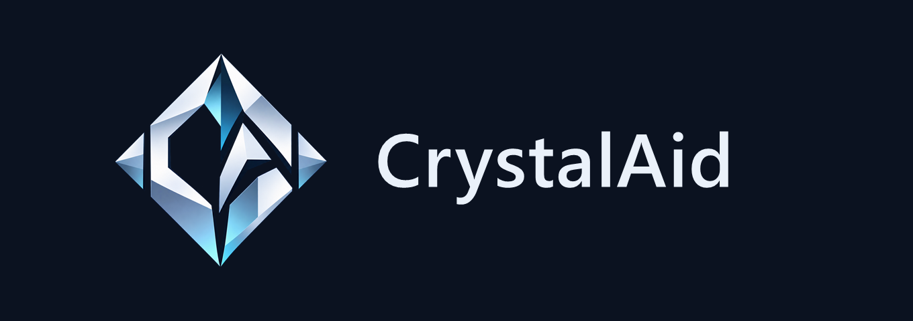

  

# CrystalAid

Discord-бот и Discord Activity для учёта ветки стаффа: тикеты, смены и нормы, онлайн, кадры, отчёты, зарплата в токенах и внутренний магазин.

Одно приложение делает всё: бот, Activity-панель, API и worker запускаются одним контейнером на порту 3000. Готовы ядро (API, вход через Activity, уровни и права, аудит), дизайн-система с оболочкой Activity и бот (тикеты в личных сообщениях, расписание ПТ, `/menu`, `/dev`). В панели готовы только разделы Обзор и Настройки, остальные разделы пока заглушки.

## Развёртывание на bothost

Репозиторий `crystalaid-bot`, ветка `main`, собственный Dockerfile включён, домен включён, порт `3000`. Команда запуска не нужна: `CMD` из Dockerfile запускает `scripts/start-all.mjs`.

Переменные:

| Переменная | Нужна | Что это |
|---|---|---|
| `DISCORD_BOT_TOKEN` | да | токен бота |
| `DISCORD_CLIENT_ID` | да | id приложения Discord |
| `DISCORD_CLIENT_SECRET` | да | секрет OAuth2 |
| `DATABASE_URL` | да | строка подключения PostgreSQL |
| `CONFIG_JSON` | да | серверный конфиг одной JSON-строкой (образец `crystalaid.config.example.json`) |
| `JWT_SECRET`, `SERVICE_TOKEN` | нет | если не заданы, создаются при запуске (после перезапуска новые) |
| `TRUSTED_PROXIES` | нет | IP или CIDR обратных прокси через запятую |

Redis внутри контейнера, отдельный не нужен.

Developer Portal: включить Server Members Intent и Activities; в URL Mappings добавить `/` и указать домен приложения.

Подробности и проверки вручную: [Развёртывание](docs/deployment.md).

## Локальный запуск

Нужны PostgreSQL, Redis, `.env` (образец `.env.example`) и `crystalaid.config.json`. Затем `pnpm install --frozen-lockfile`, `node scripts/start-all.mjs`. Тесты: `pnpm test`, типы: `pnpm typecheck`, линтер: `pnpm lint`.

## Документация

[Архитектура](docs/architecture.md), [API](docs/api.md), [База данных](docs/database.md), [Безопасность](docs/security.md), [Тесты](docs/testing.md), [Развёртывание](docs/deployment.md), [Интерфейс](docs/ui.md), [Поведение интерфейса](docs/ux.md), [Адаптивность](docs/responsive.md).

Брендинг лежит в [`brand/`](brand).
